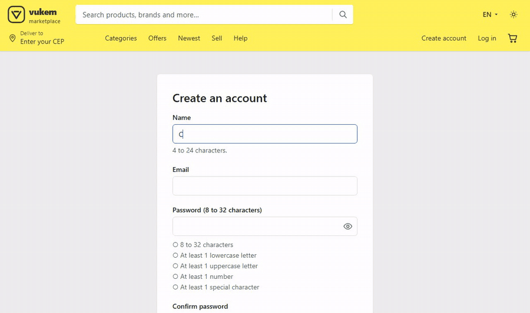
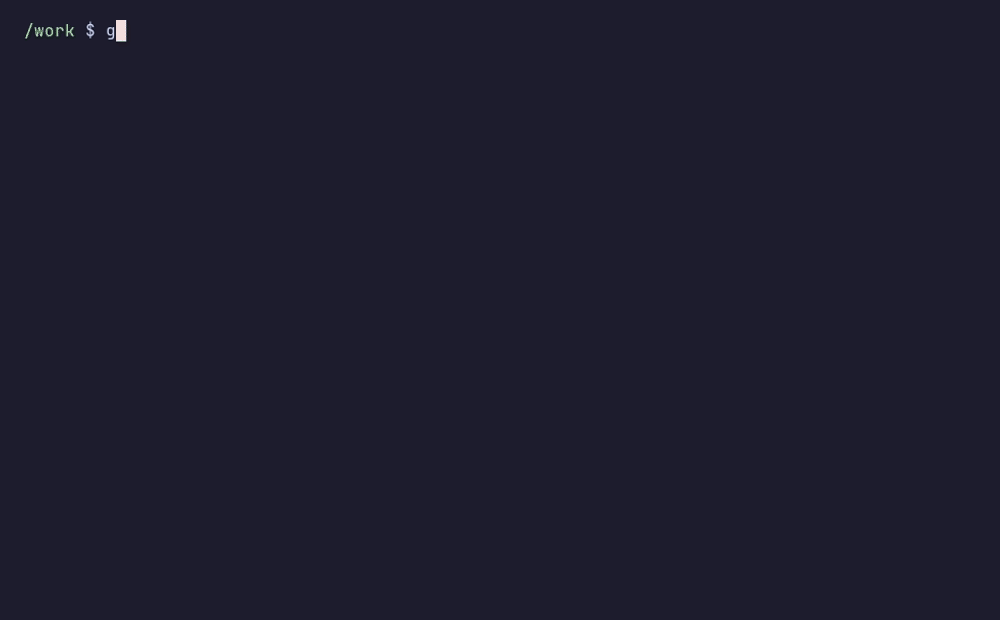

<h1 align="center">Vukem Marketplace</h1>

<p align="center">
  <a href="https://github.com/AlexGalhardo/vukem-marketplace-reactjs/actions/workflows/ci.yml"></a>
  <a href="https://github.com/AlexGalhardo/vukem-marketplace-reactjs/actions/workflows/release.yml"></a>
  <a href="https://github.com/AlexGalhardo/vukem-marketplace-reactjs/releases"></a>
  <a href="https://github.com/AlexGalhardo/vukem"></a>
  <a href="LICENSE"></a>
</p>

## Introduction

Vukem Marketplace is an open-source multi-seller marketplace built with the [Vukem](https://github.com/AlexGalhardo/vukem) Go framework, Inertia v3, React 19, Base UI and Tailwind CSS v4. Its layout is inspired by the big Latin American e-commerce sites (not affiliated, no brand assets). It runs in production at <https://marketplace.vukem.dev> and is the flagship battle test for Vukem 1.0.

## See it working

### Create an account

Name, email and password limits with a live password checklist and a show/hide toggle, all validated by Vukem `z` on the server.



### Search, suggestions and cart

Suggestions from 3 characters: the 8 best products with image, title, category and price. Keyboard friendly.


### Dark and light themes


### Checkout

Cart, delivery address and the review-and-pay step with server-side freight and totals. PIX (AbacatePay) and card (Stripe Connect) are enabled by adding the provider sandbox keys; the local stack in this recording has none, so both show as unavailable.


### Live chat with the seller

WebSocket chat between a buyer and a seller in two separate sessions.


### Tests



All GIFs are recorded against the local stack with `bun scripts/record-readme-gifs.ts` (see [tooling](docs/tooling.md)).

## Summary

| Area | What you get |
| --- | --- |
| **Storefront** | Home sections, Postgres full-text and trigram search with filters, sorting and live suggestions in the navbar, category, product and shop pages, recently viewed products, EN/PT-BR and dark/light themes. |
| **Sellers** | One shop per seller, products (draft/published/archived) with S3 images and 320/640/1280 thumbnails made by a queue job, orders, balance from a ledger and payout requests. |
| **Cart and checkout** | Server-priced multi-seller cart, address book with ViaCEP autofill, freight table by weight band and region, card through Stripe Connect (Accounts v2, 10% platform fee) and PIX through AbacatePay. |
| **Community** | Reviews of paid order lines with votes, replies and moderation; product questions answered by the shop; live buyer-seller chat over WebSockets with SSE/polling fallback. |
| **Auth** | Email/password, Google sign-in, email verification, password reset, TOTP two-factor with recovery codes, account and security pages; admin area behind the admin role and confirmed 2FA. |
| **Public APIs** | REST `/api/v1` with OpenAPI 3.1 and Scalar docs, GraphQL with depth/complexity limits, gRPC/Connect, scoped API keys and signed, retried, SSRF-safe seller webhooks. |
| **Operations** | Queue worker and scheduler inside `serve`, `/health` and `/ready` probes, OpenTelemetry traces, Telegram alerts for backend errors and browser errors (telegram-logger), feature flags in `/admin/flags`. |
| **Demo data** | A deterministic English catalog with embedded WebP images: 100 shops, 2000 products, 300 buyers, ~1500 orders, ~1200 reviews and ~1200 questions. |

## Why this project

- **A real product, not a demo page.** Money flows, moderation, APIs and operations are complete, so every Vukem feature is tested under real constraints.
- **One domain, three API styles.** REST, GraphQL and gRPC share the same models, scopes and rate limits.
- **Secure by default.** Every item of the [OWASP Top 10:2025](PLAN.md#5-owasp-top-102025-checklist) names the test that proves it.
- **Framework feedback loop.** Every Vukem bug or rough edge found here is reported upstream and fixed in the framework, not hidden in the app.
- **Windows is first-class.** Pure Go, no C compiler; developed on Windows 11, deployed on Linux.

## Stack

| Layer | Choice |
| --- | --- |
| Backend | Go 1.27, Vukem (`contrib/graphql`, `contrib/grpc`, `contrib/stripe`, `contrib/imaging`, Postgres, Redis, MongoDB, S3, WebSocket and OpenTelemetry drivers) |
| Frontend | Inertia 3.9, React 19.3, TypeScript 7, Base UI 1.9, Tailwind 4.3, Vite 8 |
| Data | PostgreSQL 18 (core), Redis 8 (sessions, cache, queues, rate limits, chat fan-out), MongoDB 8 (audit, history, telemetry), S3-compatible storage (RustFS locally) |
| Payments | Stripe Connect (card, test mode), AbacatePay PIX (sandbox) |
| Email | Mailtrap (Email Sandbox in development and CI, HTTP API in production), Mailpit offline |
| Tooling | Bun 1.4, Biome, Playwright, golangci-lint, lefthook, commitlint |
| Hosting | Railway (Docker image), images on GHCR |

## Quick start

Requirements: Docker with Compose, Bun 1.4.3 and the Vukem CLI (`go install github.com/AlexGalhardo/vukem/cmd/vukem@latest`).

1. Clone the repository and enter it.

   ```sh
   git clone https://github.com/AlexGalhardo/vukem-marketplace-reactjs.git
   cd vukem-marketplace-reactjs
   ```

2. Create your environment file.

   ```sh
   cp .env.example .env
   ```

3. Generate the app key (it is written to `.env`).

   ```sh
   vukem key:generate
   ```

4. Install the JS dependencies and git hooks.

   ```sh
   bun install
   ```

5. Start the whole stack (app, worker, scheduler, databases, storage, mail catcher).

   ```sh
   docker compose up -d --build
   ```

6. Check that it is ready, then open <http://localhost:3200>.

   ```sh
   curl http://localhost:3200/ready
   ```

7. Log in with a demo account: `buyer@example.com`, `seller@example.com` or `admin@example.com` (password `marketplace-demo-password`, development only).

Prefer hot reload on the host? See [setup without Docker](docs/setup-local-without-docker.md).

| Service | URL |
| --- | --- |
| App | <http://localhost:3200> |
| Mailpit | <http://localhost:8035> |
| RustFS console | <http://localhost:9201> |
| Postgres / Redis / Mongo | `localhost:5442` / `6389` / `27027` |

## Checks

```sh
golangci-lint run ./... && go test -race ./...
bun run lint && bun run typecheck && bun run build
bun run test:e2e                # needs the compose stack and `bunx playwright install chromium`
```

Integration tests and the email-testing setup (Mailtrap) are described in [PLAN.md](PLAN.md#91-commands).

## Documentation

- [Architecture and system design](docs/architecture-system-design.md)
- [Local setup with Docker](docs/setup-local-with-docker.md) and [without Docker](docs/setup-local-without-docker.md)
- [Deploy on Railway](docs/setup-deploy-railway.md)
- [Tooling](docs/tooling.md)
- [Demo data and images](docs/demo-data-and-images.md)
- [Telegram logging](docs/telegram-logging.md) (backend with Vukem, browser with telegram-logger)
- [PLAN.md](PLAN.md): decisions, data model, money flows, routes, APIs, OWASP checklist, roadmap
- [vukem-feedback.md](vukem-feedback.md): bugs, gaps and ideas found while building on Vukem
- [CHANGELOG.md](CHANGELOG.md): every release, each entry linked to its commit
- [AGENTS.md](AGENTS.md) and [CLAUDE.md](CLAUDE.md): rules for coding agents

## Agentic development

The project is developed with AI coding agents. [AGENTS.md](AGENTS.md), the path-scoped rules in `.claude/rules/` and the skills in `.claude/skills/` describe the conventions, the test-first workflow and the security contract every change follows.

## Contributing

Thank you for considering contributing! Read the [contribution guide](CONTRIBUTING.md) to get started.

## Security vulnerabilities

If you discover a security vulnerability, please follow the [security policy](SECURITY.md) instead of opening a public issue.

## License

Vukem Marketplace is open-source software licensed under the [MIT license](LICENSE).
